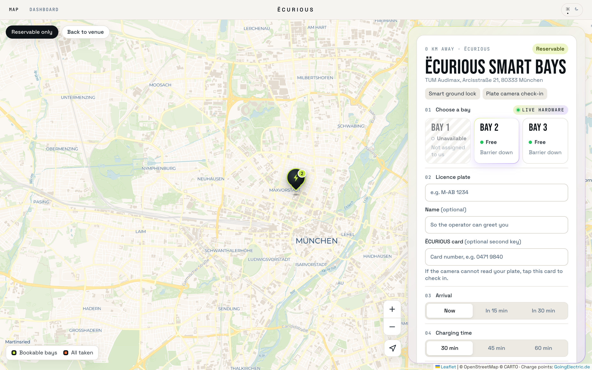
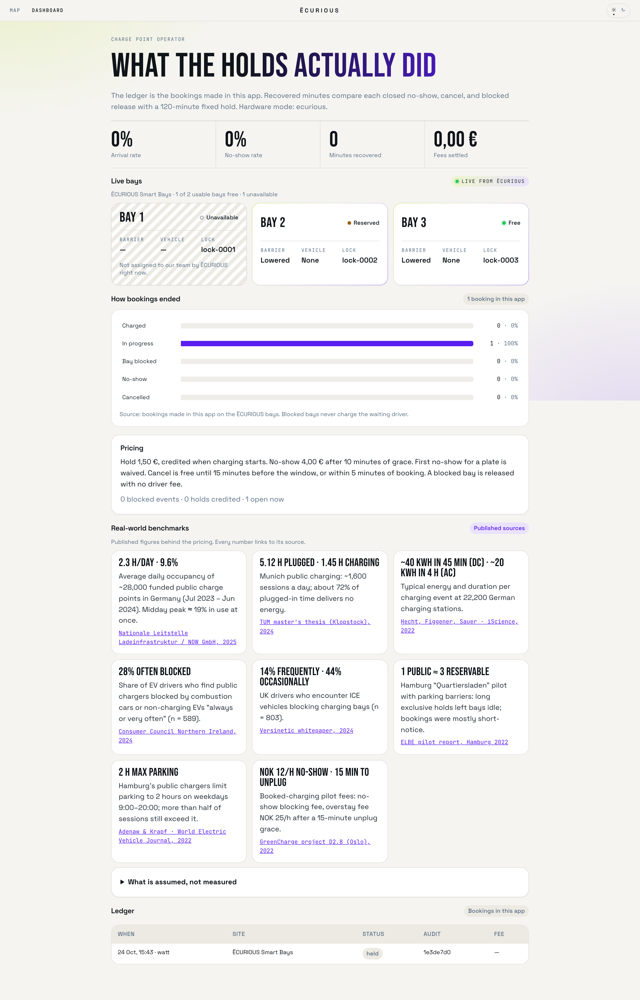
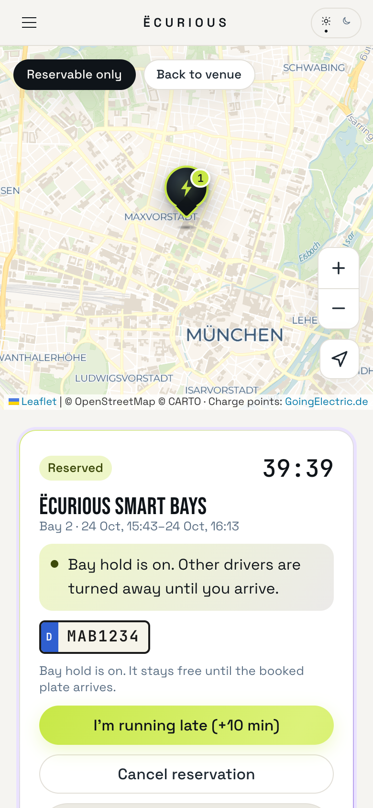

# BayHold

**A charging bay that is free when you arrive.** Smart reservations for public EV charging, built on real ËCURIOUS parking locks for the Ecurious Smart Reservation Challenge at WATT THE HACK Munich 2026.

**Live demo:** https://bayhold.onrender.com. Leave `SHOWCASE_MODE` unset or `false` on the host so a reservation commands the locks. Set it to `true` only to watch live status without moving the barriers.

| Map and booking | Operator dashboard | Phone |
|---|---|---|
|  |  |  |

## What it does

- Live map of public charge points from the GoingElectric API
- Reserve a bay: the ËCURIOUS barrier rises and the booked plate is written into the lock's camera
- Plate check-in: the camera recognises the car and lowers the barrier; the ËCURIOUS card works as a second key
- No-show, blocked-bay and unclear-plate handling with fair, transparent fees
- OCPI 2.2.1 bookings from other charging apps
- Operator dashboard with live bays, booking outcomes and sourced benchmarks
- Privacy by design: plates and cards stored only as salted hashes, masked everywhere


A charging-app prototype for the Ecurious challenge. Drivers see public charge points, reserve a bay with hardware, check in by license plate, charge, and release the bay. The same server covers no-shows, a vehicle already in the bay, a reservation created by another app, and a small utilisation ledger.

This is a prototype. With `ECURIOUS_BASE_URL` and `ECURIOUS_API_KEY` set, the BayHold Smart Bays site is the three live locks. It does not call public or production chargers.

## Run

```bash
npm install
npm run dev
```

Open http://localhost:3000.

1. Leave **Reservable only** on and open **BayHold Smart Bays**. The theme control is a sun/moon icon. On a phone it sits in the menu.
2. Plate `M-WA 1001`. Arrival **Now**, **In 15 min**, or **In 30 min**. Charging time **30 min**, **45 min**, or **60 min**. Tick the plate notice, then **Reserve this bay**.
3. Arrive by driving onto the bay. The lock camera checks the plate in. Tap **Start charging**; the lock does not meter energy. **End session and release** closes the hold. The bay frees when the camera sees the car leave.
4. Open **Dashboard** for the operator ledger of bookings made in this app.
5. Set `GOINGELECTRIC_API_KEY` for live GoingElectric data. Each live station links to its GoingElectric entry, as the API terms require.

## Environment

See `.env.example`.

| Variable | Role |
| --- | --- |
| `GOINGELECTRIC_API_KEY` | Server-side directory search. Without it, the map shows only the BayHold bays and says why. |
| `ECURIOUS_BASE_URL` | Ecurious hardware server, e.g. `https://parking-lock-service-production.up.railway.app`. When set with a key, the test bay drives the real locks. |
| `ECURIOUS_API_KEY` | Team key for the Ecurious hackathon API (sent as `X-API-Key`). The BayHold Smart Bays site maps to `lock-0001…0003`. |
| `ECURIOUS_DEVICE_KEY` | When set, camera posts must send `x-device-key`. |
| `SHOWCASE_MODE` | Leave unset or `false` so a reservation commands the locks. Set `true` to read live status and events without moving the physical locks. |
| `APP_PASSWORD` | Optional. Set it for any public deployment; the browser asks for it (any username). |
| `OCPI_TOKEN` | Optional. When set, OCPI partners must send `Authorization: Token <value>`. |
| `PLATE_HASH_SALT` | Salt for plate hashes. The demo salt is not a secret. |
| `NEXT_PUBLIC_VENUE_LAT`, `NEXT_PUBLIC_VENUE_LNG` | Where the BayHold bays stand and where the map opens. Set to the venue, TUM Audimax (48.14956, 11.56744). Optional `NEXT_PUBLIC_VENUE_STREET`, `_POSTCODE`, `_CITY`. |

## API

- `GET /api/stations?lat&lng&radius&minPower`
- `POST /api/reservations` `{ stationId, bayId, plate, holderName, durationMin, startsInMin, consent }`
- `GET /api/reservations/:id`
- `POST /api/reservations/:id` `{ action }` where action is `cancel`, `late`, `confirm_plate`, `reject_plate`, `charge`, `release`, `bind_plate`, or `reroute`
- `GET /api/hardware` live lock status and the recent Ecurious event log
- `GET /api/operator/summary` and `POST /api/operator/reset`
- `POST /api/ocpi/2.2.1/commands/RESERVE_NOW` and `CANCEL_RESERVATION`

OCPI replies immediately. `response_url` is not called. `data.check_in_url` is a BayHold extension because OCPI has no license plate.

## Pricing and utilisation

Hold €1.50, credited if charging starts. Grace 10 minutes. One 10-minute late extension. Cancel free until 15 minutes before the window, or within 5 minutes of booking. No-show €4, first one waived per plate. A blocked bay is not charged to the waiting driver.

Recovered minutes use a 120-minute fixed-hold baseline: `max(0, 120 − minutes the bay was actually held)` for no-shows, cancellations, and blocked releases. Completed charges recover zero minutes because the bay was used. The operator page states that baseline. It is not a city-wide claim.

## Plate data

This is a prototype design, not a legal assessment. The driver consents before a BayHold booking. The raw plate is stored only while the hold is active, then cleared 24 hours after it ends. A salted hash remains for the no-show waiver. Blocked vehicles are shown masked. Operators see an eight-character audit reference.

## What did not work

- GoingElectric is fetched on the server so the key stays off the browser. The provider’s terms prefer a device fetch. The map names the source and links each entry. If the key is missing or the request fails, the map shows an error, not invented sites. Nothing is scraped.
- The lock does not meter energy. “Start charging” is the driver confirming they plugged in.
- The lock does not report its map position. The pin is the configured venue, TUM Audimax, taken from the event page. The locks share that one pin.
- The lock does not send an OCR score. A complete plate is a confident read. A broken read waits for the driver.
- A vehicle the lock already reports blocks a new booking. An old photo on the lock is not replayed into a reservation.
- The app does not speak OCPP to a charge point. ReserveNow is only the model for the hold. OCPI `response_url` is not called.
- One `data/state.json` file is the store. Two server processes would not share it.

## Project structure

- `src/app/`: Map (`/`), Dashboard (`/operator`), docs (`/docs`), check-in (`/r/[id]`), and the API routes. The header is Map and Dashboard.
- `src/components/`: the map, booking panel, live bays, chart, and sun/moon theme control
- `src/lib/ecurious.ts`: the link to the Ecurious locks (commands, live events, 8-second sync)
- `src/lib/store.ts`: bookings and the rules (grace period, fees, plate matching, privacy)
- `src/lib/goingelectric.ts`: public charge points for the map
- `src/lib/stations.ts` and `src/lib/venue.ts`: the BayHold bays (lock-0001 to lock-0003) at TUM Audimax; Ecurious assigns locks to teams and can change them, and the app follows the live assignment
- `docs/screenshots/`: screenshots of the app
